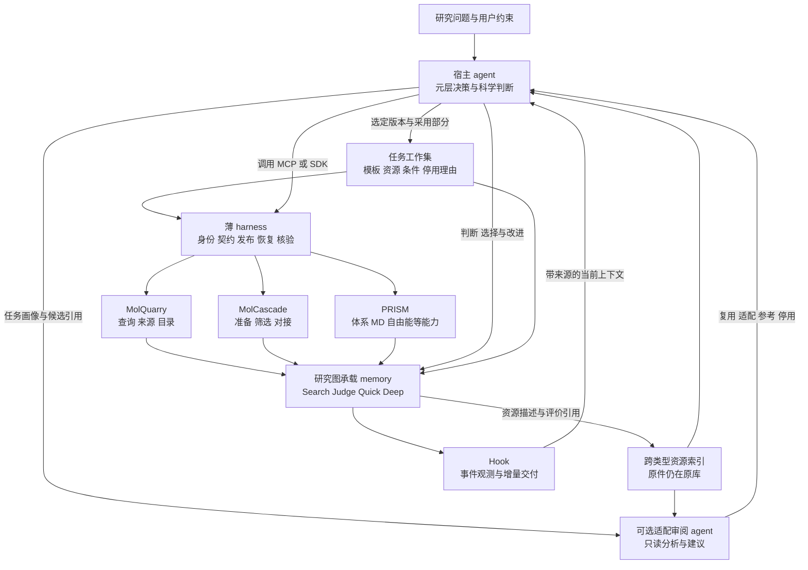

# ETALON 元层与任务工作集设计

日期：2026-10-23。状态：第一批已实现画像、跨类型索引、适配审阅、工作集、checkpoint 发布、上下文及 hook/导出接缝；具体 API 与验收边界见 [第一批工程说明](META_WORKSET.md)。本文其余内容保留总体设计，未列入该批交付的部分仍是后续设计。不据此声称 PRO6000 的默认版本已更新。资源分配不在范围内；R4b 保持暂停；PoseBusters 原生 hook 验收继续等待既定审阅。

核心设计：**宿主 agent 负责当前问题及其方法选择；元层是它管理知识继承、适配和组合的职责。资源分散保存、统一索引；每项任务固定自己的工作集；hook 交付工作集变化。** 跨领域适配可委派给独立小上下文 agent 审阅，由宿主采纳或调整结论。科学执行继续使用 MolQuarry、MolCascade、PRISM 及已有 SDK/MCP。

## 1 元层的位置与决策权



**推荐主路径由调用 MCP 的那个宿主承担元层职责，旁路只承担可选审阅。** 元层可以表现为一个使用 skill 的角色，无须常驻第二个总管进程。

| 角色 | 负责 | 权限边界 |
| --- | --- | --- |
| 宿主 agent | 定义问题，选择模板与资源，判断审阅建议，组装 workflow，调用科学能力，决定是否触发 RSI | 当前任务只有一个工作集发布负责人；直接用 SDK、跳过 skill 或停止仍有效 |
| 适配审阅 agent | 检查知识能否迁移、缺什么条件、哪些部分值得试；给出短理由与依据 | 默认只读，不提交计算，不改全局默认，不替宿主激活工作集 |
| 薄 harness | 校验身份、引用、输入契约、发布并发和收据；保存可恢复状态 | 不通过字符串匹配推断科学适用性，不增加全局强制 workflow |
| Hook | 发现可观测变化，读取当前已发布状态，交付差量及恢复入口 | 不在事件回调里启动 agent 审阅、科学计算或优化循环 |
| 三个组件 | 接收明确参数，执行能力，返回产物与实际使用信息 | 不因名称或所在层而获得跨任务选择权 |

审阅 agent 适合任务跨度大、候选很多、需要隔离旧经验影响时启用。小变化可由宿主直接完成同一份审阅契约；证据不足时可选择任务模板继续。审阅不是每次工具调用的必经环节。这里的“审阅”是科研适配判断，不新增人工批准流程。

### 1.1 Index skill 可以承载适配审阅

首批可以收拢成 **index + index skill + 工作集**。适配审阅是 index skill 的一种用途，无须先建设独立的“元 agent 服务”。同一个 skill 既能由宿主运行，也能交给独立上下文的审阅 agent。独立 agent 是执行形式，skill 是方法，二者分别版本化和记录。

| 对象 | 回答的问题 | 需要保留的状态 |
| --- | --- | --- |
| Index | 有什么资源，在哪里，声明了什么范围，依据是什么 | 精确身份、出处、条件、关系、未知与覆盖 |
| Index skill | 对当前问题应该查什么、缺什么、哪些部分值得采用 | 检索依据、适配结论、备选及未决项 |
| 工作集 | 这个任务最终选了什么，现在启用了什么 | 选定版本、实际采用范围、激活决定和接续状态 |

足够好的 index 能承担很多适用性检查，尤其是显式条件、依赖、版本和失效关系。但未记录的科学前提不能靠索引结构自动补全。Index skill 可沿来源补查；它推断出的条件必须标为解释或假设，不能静默回填成原作者已经证明的范围。

Index skill 建议有两个可单独调用的用途，均为待实现设计：

- **整理资源**：从新增/变更的原件提出索引描述，保留直接提取与推断的区别；确定性代码校验身份、引用和版本后入档。旧资源缺条件时显式留空，不默认通用。
- **服务当前任务**：读取任务画像，取候选摘要，按需展开支持/反证，产出适配审阅和工作集建议。宿主选定后用已有发布接口落档。

它还应返回查过的范围、未查范围、缺少的关键条件及回模板的理由。索引新增描述与修改科学方法是两件事；整理一次索引不应自动触发一次 RSI。索引策略或这个 skill 自身的改版，沿现有方法版本和评价机制比较遗漏、有害迁移、成本及后续决策效果。

这三个对象可以放在同一轻量模块中，通过既有 Artifact 保存不同记录；不要求三个服务或三个数据库。工作集即使物理上存于同一索引，也必须是任务绑定、版本固定的记录，不能由一次可变的“最新检索结果”代替。

## 2 研究图与资源库的关系

研究图继续承载本次研究的 memory：Search 找来源，Judge 形成判断，Quick 做快速计算，Deep 承接耗时长、费用高、信息量大的计算或 lab 合作。节点与分支可以跳过、复用、局部展开和回边。

跨类型索引是这些记录及代码资产的**可重建目录**，不是第五张研究图，也不保存另一套科学真相。适配审阅、选用和停用决定落在 Judge 的现有研究步骤上；实际采用连接到 Quick/Deep 等执行节点；新的经验仍有产生它的研究来源。

| 资源类型 | 原件所在位置 | 索引指向什么 | 可以继承的粒度 |
| --- | --- | --- | --- |
| Skill | `.claude/skills/`、组件原生 skills、安装包 bundle | 完整内容快照与成员哈希 | 整个 skill、具体段落或脚本能力 |
| 科学方法与参数契约 | 代码、配置、MethodVersion、参数契约 Artifact | 实现与环境身份、参数定义、必需检查 | 通用算法、具体实现、参数配置分别选择 |
| Workflow 与组装规则 | workflow Artifact、对应方法版本 | 节点、边、前置条件与组成版本 | 子图、节点、选择规则分别选择 |
| Claim 与已有证据 | ResearchJournal、来源快照、原始文件 | 精确 evidence ref、适用条件、反证 | 事实、解释、假设分别引用 |
| RSI 经验与分支规则 | improvement experience、评价及决策记录 | 采用/保留/回退结果、支持与失败案例 | 可检索参考或受限使用，不自动升级为默认 |
| Verifier 与任务模板 | 核验代码、冻结协议、输入输出约定 | 评价版本、用途、可见性、前置条件 | 按任务选择；评价标准不能随候选自行放宽 |

“SND1 库”“姿势预测库”“通用接续库”是逻辑资源集合，可以交叉引用同一资源。内容按哈希去重；不同研究对同一内容的评价、范围和来源保持分别可查。库被新增一条经验，不等于所有任务立即继承它。

## 3 新增的四份契约

以下名称和字段为拟议契约，不是当前已注册的 schema 或 MCP 工具。第一版沿用普通 Artifact 存储，避免新建数据库或复制原始证据。

### 3.1 任务画像 TaskProfile

任务画像描述“当前在解决什么问题、决策前能看到什么”。领域标签只是检索线索，不能独自决定迁移。

| 字段组 | 最小内容 |
| --- | --- |
| 问题与产物 | `task_id`、问题、输入身份、期望输出、任务类型，例如结构准备或姿势排序 |
| 科学条件 | 靶点/口袋、分子与化学状态、模板关系、约束来源；未知显式记录 |
| 方法环境 | 组件能力、方法/工具/模型身份、协议、所需输入输出契约 |
| 评价条件 | 成功指标、比较基线、评价版本、数据划分与用途；包含封存引用但不暴露答案 |
| 决策时点 | 当前阶段、已可见特征及来源，例如 CPU 对接后、CNN 前 |
| 执行状态 | checkpoint、分支、完成收据、pending、暂停和用户硬约束 |

同一靶点换了评价目标也可能需要重审；不同靶点采用同一机械恢复机制则可复用。任务画像的语义身份不包含 chat ID。另存来源水位，避免每次普通结果落档都被误认成全新问题。

### 3.2 跨类型资源描述 ResourceDescriptor

每项描述包含：

- `resource_id/type/content_ref/version`：稳定身份、类型和精确版本；路径只是定位，不是身份。
- `parts/dependencies`：可选部分、依赖闭包、相关契约；局部采用不能漏掉所需脚本或规则。
- `applies_to/requires/invalid_when`：声明范围、必须确认的条件、已知失效条件。
- `support_refs/counter_refs/coverage`：证据、反证及覆盖缺口；“无命中”和“尚未查全”分开。
- `visibility/available_at`：研究或评价用途、何时可使用；过滤先于摘要和 agent 审阅。
- `lineage/producer_refs`：从哪个版本演化、由谁以什么使用记录产生；内容父版本与产生方法分开。

索引先返回有限摘要，再按精确引用展开；范围、游标、截断、排除原因和不可用来源必须可见。第一版可用确定性字段检索，不依赖向量数据库。老资产缺字段时标为 `unknown`，不能因缺少限制字段就获得“通用”身份。

现有 `improvement.conditions` 是非空字符串映射；它检查的是历史记录声明过的条件，不能发现当时根本没写的条件。因此新增画像与适配规则须定义任务类型的关键维度，使用 `match / conflict / unknown / not_applicable`。不能将数值范围、未知值或结构化条件偷偷编码成旧字段并假称已有比较语义。

### 3.3 适配审阅 AdaptationReview

输入为任务画像、候选索引快照、按权限可读的依据、固定审阅方法版本，以及必要的旧工作集引用。适配 agent 首轮只收到候选摘要，不先加载全部 SND1 经验再决定是否隔离。

每个候选的输出分开表达三件事：

| 维度 | 值与含义 |
| --- | --- |
| 适用性 | 匹配、冲突、未知；列出逐项条件与缺失信息 |
| 使用决定 | `reuse` 原样使用；`adapt` 改造候选；`reference` 仅供判断；`exclude` 不进入活动工作集 |
| 证据强度 | 可直接复用的机械能力、已在所述范围验证、待验证迁移假设、已有负证据 |

同时记录选择/省略的部分、支持和反证、简短理由、重新考虑条件，以及候选覆盖是否完整。agent 的判断是带依据的意见，不由一个自报置信分自动变成科学事实。评审过程记录版本、输入、读过的引用、输出与成本，不要求保存私有逐步推理。

`adapt` 产生新候选和依赖绑定，不直接更改原件；进入正常执行后按现有 RSI 流程评价。`exclude` 表示此任务不激活，原因可能是冲突、无价值、证据不足或当前不需要，不能混为“已证明无效”。

### 3.4 任务工作集 TaskWorkset

工作集固定“这个任务当前采用哪些资源的哪些部分”，不复制全部正文。

```text
TaskWorkset
  task_profile_ref + template_ref
  selected[]       精确资源版本、采用部分、模式、条件、审阅依据
  excluded[]       候选引用、理由、重新考虑条件
  dependency_refs  实际需要的完整依赖
  review_ref
  visibility_policy_ref + scope_fingerprint
  index_snapshot_ref + source_watermarks
  parent_workset_ref
```

生命周期为“候选 → 宿主选定 → 随 checkpoint 发布 → 被新版本替代”。这些是追加的事件和指针变化，旧工作集字节不改。冲突或缺证可以形成模板工作集，无须伪造适配成功。

激活决定反向引用工作集；工作集不包含指向该决定或未来 checkpoint 的引用，避免内容哈希形成循环。任务画像只引用它形成时已有的状态。

两个重要区分：**选入工作集不等于实际使用；实际使用不等于已证明有效。** 节点的 MethodUse 记录实际采用部分，执行收据证明运行，评价证明限定范围内的效果。后续选择再引用这些评价与经验。

## 4 何时审阅 何时回到模板

| 触发 | 动作 | 是否重新计算 |
| --- | --- | --- |
| 新 chat，任务条件与已发布工作集未变 | 读取原工作集、状态和差量 | 否 |
| 新问题，靶点/任务类型/评价目标或输入契约实质变化 | 对受影响的资源做适配审阅 | 审阅本身不触发科学运行 |
| 新反证、依赖版本变化、来源不可用 | 将受影响资源标为待复核，保留未受影响部分 | 由宿主决定下一步 |
| 普通产物落档，画像未变 | 更新 memory 与 hook 差量 | 不自动产生 RSI 机会 |
| 具体失败、成本或质量问题形成可修改假设 | 复用正常执行 RSI 入口 | 按明确任务授权和协议运行 |

以下情形回到**适合当前任务的、固定版本的基础模板**：没有可复用资源；关键条件冲突；重要条件未知且继续查证价值不足；适配候选失败；审阅未完成而宿主选择先走基线。记录原因与未决项，不删除历史。

模板包含基本输入输出、可选方法、证据记录、恢复方式和质量检查，不是固定全流程，也不是普适最优方法。模板自身前置条件不满足时，停在补输入或科学判断，不能用“回到模板”掩盖无效输入。检索系统出错应记录 `review_unavailable`；不能写成“查过，没有价值”。

模板、普通方法、适配候选都可以被宿主部分采用、组合或跳过。机械校验强制已有的身份、权限和执行契约；适配建议不新增覆盖所有 MCP 调用的方法 gate。绕过建议的显式探索可以发生，但不得冒称在既有工作集内已经获得验证。

## 5 Hook 与宿主 memory 的分工

元层决定上下文内容及使用范围；hook 负责可靠触发与交付。新增能力是对已发布工作集的投影，不是 hook 内嵌一个隐形研究 agent。

| 时点 | 拟议行为 | 需要保留的状态 |
| --- | --- | --- |
| SessionStart | 交付当前任务摘要、精确工作集、暂停/pending、待读引用 | checkpoint、工作集版本、来源覆盖 |
| 工具调用前 | 对明确绑定的任务/输入检查版本变化，必要时提示适配待复核 | 声明条件和当前可见输入；不从所有任意工具参数推断科学语义 |
| 工具调用后 | 发现已发布的新产物或决策，交付差量 | 真实收据与 agent 自述分开；未发布产物保持待落档 |
| 工作集切换 | 发布新增、撤销、改为仅参考的资源清单和新基线 | 精确旧/新版本；跨任务禁止误用旧 delta 基线 |
| PreCompact / Stop | 暴露当前入口和未发布进展；需要判断的整理由 skill/宿主做 | 未完成的 publication intent，未落档状态 |

工具返回但尚未落档时，hook 不能假装 checkpoint 已包含进展，也不能自行把文本编成科学结论。恢复先核查现有收据与待发布 intent，再显式完成落档。

“hook 掉旧 RSI 内容”具体实现为停止后续默认注入、撤销工作集激活、切换当前方法配置，并保留可检索的历史引用。**它不能删除模型已经看到的对话，也不能接管所有宿主私有 memory。** 任务跨度很大时，可用新 chat 或干净上下文启动，携带新任务入口；同一 chat 只能明确标记旧建议已失效。

还有一个真实工程缺口：目前 `host._payload` 导出整个 `skills.WORKFLOWS`。仅过滤 MCP 上下文，不能阻止宿主从导出目录发现其他 skill。需新增按工作集导出的任务 skill 集合，并保留依赖闭包；旧的全量导出方式继续可用。全局预装 skill 仍可能可见，因此导出隔离不宣称等于模型记忆隔离。

hook 的 delivery receipt 只证明交付准备或事件处理，不证明 agent 理解、采用了内容。实际使用通过 MethodUse、节点、参数消费与后续行为核查。来源数据不能借 hook 升格为宿主必须服从的指令。

## 6 从 SND1 切换到 PoseBusters

**SND1 是靶点/研究系列，PoseBusters 是姿势评价体系及其数据集；二者不是同一种分类维度。** 以下是已有具体研究任务之间的切换示例，不是将“所有 SND1 知识”与“所有 PoseBusters 任务”判为不相容。

匹配需要同时看靶点、分子/骨架与模板关系、任务目标、方法接口、评价协议、数据用途和决策时点。一个任务可以同时命中通用分子方法、某靶点和某评价协议的多个资源集合。面板级工作集保留共享资源，每案例/分支只增加受条件支持的选择；无需为每个案例复制整套库。

| 对应情况 | 应采取的处理 |
| --- | --- |
| 同一个 SND1 问题与协议，只有新 chat 或中断恢复 | 读原工作集和收据，不因会话变化重新审阅或计算 |
| 同靶点，换分子或骨架 | 重查模板覆盖、锚点和化学状态；可继承靶点背景，不能自动继承固定核心与参数优劣 |
| SND1 姿势准备转为多靶点 PoseBusters 对照 | 继承通用机制；逐案例检查局部方法是否适用，不搬运整套 SND1 默认值 |
| 新案例确有与 SND1 方法相同的必要条件 | 对相应方法部分审阅复用或适配；不能只因属于 PoseBusters 就排除它，也不能只因同靶点就采用 |
| PoseBusters 内切换到新面板、引擎或决策阶段 | 重查相关条件；同一数据集名称不保证经验可迁移 |
| 换成不同科学问题或领域 | 保留通用基础设施，检索领域资源；缺乏合适候选时使用该任务的模板 |

即使结构身份完全相同，若该结构在当前任务中是 evaluation-only 答案，也不能借“同源知识复用”进入预测输入或适配 agent 的可见上下文。

### 6.1 切换前固定旧状态

先保存 SND1 最新 checkpoint、完成收据、待办、已采用方法与其适用条件。旧任务仍可恢复；工作集切换不取消旧进程、不改变旧请求绑定，也不把 SND1 的完成状态复制为 PoseBusters 的完成状态。

SND1 的问题是具体模板和化合物关系下的姿势准备与局部改进。PoseBusters 对照的目标是新案例的姿势预测/排序及物理合法性，两者的输入关系、比较方法和评价范围不同。是否共享“分子”标签不能代替适配审阅。

### 6.2 对具体资产作出不同处置

| 资产 | 切换时的处置 | 理由与落档 |
| --- | --- | --- |
| Journal、证据身份、publication、checkpoint、请求恢复 | 继承机制 | 用新任务身份、新执行请求；历史结果只在完整输入/协议绑定一致时复用 |
| 上下文读取、证据定位、失败与反证保留 | 继承机制 | 检索范围切换到当前问题，不能把历史方法意见当全局指令 |
| 硬固定/软约束/方向性相互作用的输入表达 | 按所需部分继承 | 可复用表示与校验；不能继承 SND1 的具体数值、锚点或约束必要性 |
| SND1 受体、固定核心、允许转动连接键、关键残基与活性证据 | 默认不激活，保留引用 | 尚无条件说明它们适用于新案例；也不能把靶点活性当姿势或亲和力迁移收益 |
| SND1 固定核心或求解器改进经验 | 参考或适配候选 | 优势依赖具体问题和评价；不能直接成为通用 docking 默认 |
| 参数配置、候选修改、随正常执行评价的 skill | 继承通用部分 | 重新绑定姿势任务的输入、方法、评价与使用记录 |
| MolQuarry 来源读取 | 按需启用 | 已有校验过的输入时可跳过下载；来源缺失才展开相关节点 |
| MolCascade 等可用对接能力 | 根据实际执行接口绑定 | 当前 PoseBusters 示例使用 `pose_engine` 的真实 GNINA 路径，不把它写成已调用完整 Screen 工作流 |
| PRISM 的 MD/FEP 等深入能力 | 本任务默认不选 | 当前对照不需要；以后有明确问题可展开 Deep，不是全局禁用 PRISM |
| PoseBusters verifier 与任务协议 | 作为当前任务的明确基准 | 输入和评价材料按角色分离；参考答案不送给适配或选择 agent |

只有后端接受并实际消费的参数才能进入执行配置；“表示可复用”不代表任意引擎支持相同硬/软约束。

### 6.3 不能把后来的结果提前用于选择

最初切换时，只能使用当时可见证据。没有有效迁移依据，就以冻结的姿势任务模板形成工作集，再按正常协议执行对照。

已有新 24 案例报告中，48 个案例/种子槽位的有效 Top-1 为：经验评分 40/48、固定 CNN 35/48、输入条件策略 34/48。该条件策略因此未采用。这个结果是**后续新增反证**，不能反过来声称初次元审阅已经知道 CNN 会退化。两种子也不是 48 个独立分子。

这条负经验进入索引后，对下一条相似协议任务可提示“谨慎迁移该策略”；条件变化时仍可作为候选重新研究。`retain` 表示保留比较基线、拒绝该候选，不等于证明固定 CNN 最优，更不等于全局禁止 CNN。

若以后加入口袋和 CPU 姿势池诊断，应新建适配候选，明确选择发生于 **CPU 搜索后、CNN 前**。决策冻结时只可用那时已生成的诊断；CPU 成本已经发生，不能算成被选择策略省掉。新方法要用新评价任务验证，不能把这批已看过的案例重新称为未见。

实际结果与恢复范围见 [新面板验收](../../../integration/etalon-pose-selection-20261023/ACCEPTANCE.md)。该记录证明任务 API 和进程恢复，明确没有补做本轮原生 chat/hook 验收。[SND1 示例](SND1_NORMAL_USE.md)也限定了其几何结果范围。

## 7 新 chat 如何只拿入口接续

入口保留现有 `{workspace, checkpoint_ref}` 形状，或现有一跳服务器 locator。新工作集沿 checkpoint 的研究步骤可达；不需要用户再手动提供一堆 skill 文件。

1. 调用现有 `etalon_research_context(entry=..., view="summary")`，固定返回的 `read_context`。接续摘要增加任务画像、活动工作集及其激活决定的精确引用。
2. 先读暂停、pending、发布状态、已完成节点，再按需展开工作集资源。后续 `etalon_evidence_read/query` 沿同一 `read_context`，由证据所在服务器定位原件。
3. 同任务同条件，复用已发布审阅与工作集；新 chat 本身不触发一次新 RSI。索引中出现新版本也不静默替换当前版本。
4. 工作集被替代或条件变化时，明确刷新入口，核对差异；有不完整 publication 时先恢复落档。恢复旧任务仍使用它原先固定的版本。
5. 需要继续科学运行时，核查原请求、输入、方法、种子及收据。完成的请求读回；pending 查询/恢复原句柄；状态未知先对账，不能新建一个请求冒充恢复。

工作集引用保证选择可追踪，不能独自保证所有外部引擎 exactly-once。避免重复计算仍依赖原执行端的请求身份、收据验证和恢复语义。不要把“未新增计算”单独当作完成了正向接续：还须证明未完成部分可继续推进。

对原生增量交付，切换任务或工作集版本须重置适用的基线；delta 必须绑定精确旧版本。压缩后缺基线应读当前完整摘要，不猜测应用差量。旧 chat 的交付游标不等于新 chat 已消费的上下文。

### 7.1 Subagent 与可见新 chat 分别适合什么

“是否有界面”“是否继承历史”“是否接管任务”是三个不同选择。可见的子 agent 可以有独立上下文；无头进程也可能读入旧历史。不能仅以有头/无头判断隔离是否完成。

| 场景 | 推荐承载方式 | 上下文与职责 |
| --- | --- | --- |
| 短时适配判断、反证检索、独立审阅 | 独立上下文的 subagent；宿主支持时展示其活动与结果 | 只传问题、画像、索引范围和必要引用；返回审阅，宿主继续负责当前任务 |
| 新研究方向、持续分支、需要用户直接查看与指导 | 可见的新 chat | 从任务入口开始，按需读新工作集；成为该分支明确的执行负责人 |
| 重复的索引重建或批量机械核验 | 无头任务可用 | 版本化输入输出、状态与日志可查；有科学判断时仍记录所用方法及依据 |
| 同一问题已经在推进，只需短时隔离诊断 | subagent 或临时新上下文 | 不必迁移主任务，也不复制执行权限或重复提交计算 |

默认偏好：**长期研究分支可见，短时适配审阅轻量，机械任务可无头。** 每项可见任务至少展示名称、关联研究分支、活动工作集、状态、当前动作、产物与入口；应能查看、继续指导和停止。单纯打开终端窗口不等于完成这个可见性契约。

隔离旧经验时，不复制整段父 chat。独立 subagent 显式关闭父历史继承（若宿主支持）；新 chat 使用 fresh start，输入选定入口与任务说明。需要保留旧对话的分支才使用 fork。即使 fresh start，项目指引、全局 memory、自动发现的 skills 仍可能进入上下文，须记录实际加载来源并沿用工作集导出范围；不宣称绝对遗忘。

### 7.2 最小交接协议

不让 hook 在后台自行创建 chat。由宿主根据任务需要调用其原生委派/新 chat 能力，hook 只提示状态和提供已发布的交接引用。拟议交接记录包含 `handoff_id`、目标问题、`task_id/branch_id`、入口及固定工作集引用、父子任务关系、角色（审阅或执行）、允许动作与返回要求；它作为普通 Artifact 保存，尚无新 schema 实现。

1. 先发布必要进展与工作集，形成精确的交接包。审阅 agent 收到的交接包可只读，不携带计算任务派发要求。
2. 创建/连接目标上下文，记录真实 agent/thread ID。创建结果不确定时先查询并对账；稳定 handoff ID 只帮助去重，不宣称跨宿主 exactly-once 创建。
3. 目标读取入口，回报所见 checkpoint、工作集、完成节点和 pending。这个回报证明读回了什么，不替代理解和执行验收。
4. 若接管同一分支，目标确认接收后由现有发布链登记唯一负责人，原宿主停止向该分支派发新动作；若是独立子分支则使用独立节点/请求身份。旧执行句柄及版本原样保留。
5. 后续结果沿原有节点、MethodUse、评价、checkpoint 回流。会话只是承载方式，研究状态以可校验记录为准。

Index skill、交接包或 hook 提示本身不赋予新权限；是否允许委派和创建可见 chat 仍遵循宿主接口与当前任务授权。用户已授权的动作不增加重复确认。

### 7.3 当前宿主能力与尚缺接缝

OpenAI 官方文档说明，当前 Codex 客户端支持 subagent，并可在应用中查看子 agent 的工作。这使短时审阅也能保留可见性，不必一律变成独立用户 chat。[Subagents](https://learn.chatgpt.com/docs/agent-configuration/subagents)

App Server 区分 `thread/start`、`thread/resume` 和复制历史的 `thread/fork`。设计上隔离旧任务上下文应选择 fresh start；fork 是保留历史的分支。[App Server](https://learn.chatgpt.com/docs/app-server)

本次会话可用协作工具包含 subagent 创建与消息能力，但工具发现没有返回 `create_thread` 等用户 chat 管理接口。这不等于产品不支持新 chat，也不等于任意独立启动的 app-server 会话一定出现在当前桌面侧栏。后续需核验宿主原生 thread 接口或增加显式宿主适配；ETALON MCP 本身不承担桌面 chat 管理。第一批实现已用两个独立上下文 subagent 验收 SND1 与 PoseBusters 的只读接续，尚未创建或验收侧栏可见新 chat。

## 8 与现有接口的工程对应

“复用”指现有能力；“新增”指本提案需要补的语义与适配，不表示已完成。

| 接缝 | 可直接复用 | 需新增或扩展 | 生产端与消费端 |
| --- | --- | --- | --- |
| 技能发现与版本 | `skills.library_catalog/catalog/snapshot/read_member`；`etalon_capabilities/etalon_skill_read` | 跨类型描述、来源适配器、索引快照与覆盖信息 | 各原库 → 索引 → 宿主/审阅 skill |
| 图与证据读取 | `build_research_graph/build_research_context`；evidence query/read；用途过滤 | 画像及工作集投影，范围缺失显式处理；不把 `question` 参数误写成已有语义搜索 | 原记录 → 上下文 → 宿主/hook |
| 经验匹配 | `retrieve_experience` 的范围、条件、反证、related；已有 supersedes 检查 | 关键维度清单、未知判定、适配审阅；相关命中只能提出迁移假设 | 经验 → 审阅 → 明确选择 |
| 科学输入与参数 | `scientific_input`；`method_contract`；`compile_screen_revision` 和可比性检查 | 任务画像映射、阶段可见信息、资源到实际参数绑定 | 宿主/参数 skill → 现有后端 → 消费记录 |
| 实际使用与 workflow | MethodVersion/MethodUse/MethodEvaluation；`composition.node_step/record_evaluation` | 工作集、选用决定与使用记录的可查关联；跨类型语义校验 | 方法/宿主 → 节点 → 评价/后续选择 |
| RSI 与改版 | revision context、opportunity、patch、assessment、experience；`method_revision` 的产生者归属 | 把适配失败、错误继承等记忆/选择问题作为具体改进对象 | 宿主 → 原 RSI → 条件经验 |
| 发布与新 chat | `prepare_publication/resume_publication`；checkpoint；entry/read_context；位置映射 | 工作集激活解析、摘要投影及一致性核验 | 显式产物与决定 → 原发布链 → 入口读者 |
| Hook | `research_hooks.handle_event` 的收据、baseline/delta/unchanged、恢复 | 工作集身份、撤销清单、跨任务基线、待审阅提示 | 已发布状态 → hook → 宿主；不反向执行 |
| 宿主导出 | `host.export/verify` 的内容快照与校验 | 可选工作集选择参数与依赖闭包，隔离任务导出目录 | 工作集 → 导出器 → 宿主 skill 发现 |
| Index skill | 现有目录、证据读取、上下文与经验接口 | 资源整理和任务适配两种用途，显式缺条件与工作集建议 | 原件/任务画像 → index skill → 描述/审阅 → 原发布链 |
| 可见或无头任务承载 | 宿主已有 subagent/thread 能力；现有研究入口 | 能力发现、交接包、会话绑定、读回确认与单负责人接管 | 宿主 → 子 agent/新 chat → 研究节点与 checkpoint |

### 8.1 第一版存储与兼容

第一版只新增轻量 `research/meta_context.py` 一类辅助模块及 index skill，适配审阅作为该 skill 的任务用途；模块名为建议。它负责画像/描述/审阅/工作集的构造与验证，索引由已有来源派生。宿主判断写成显式 payload，不由函数内部调用模型。可见 chat 的宿主适配单独验收，不成为每次索引读取的依赖。

已实现 SDK 操作为 `index_resources`、`prepare_adaptation_context`、`review_adaptation`、`build_task_workset`、`read_task_workset` 和 `publish_task_workset`。现有 context/capabilities/evidence 读口暴露新内容，不为每份新对象新增 MCP 工具；写入仍走已有 Journal 和 publication。

当前 research-step/checkpoint 对字段严格校验，不能直接塞入 `active_workset` 等字段。兼容路径是：

1. 第一批将带各自 schema/digest 的画像、有限索引和审阅嵌入一个不超过 32 KiB 的工作集 Artifact；原件继续用精确引用。Artifact bindings 显式列全 `evidence_refs`，供既有传递可见性过滤；不扩充旧 projection schema 枚举。更大的库由宿主先按任务缩小范围，不能静默截断。
2. 活动工作集由现有 `decision` step 显式选择：`input_refs/basis_refs` 引用审阅和依据，`output_refs` 包含唯一的有效工作集 Artifact，`supersedes` 指向同任务被替代的激活决定。新读者按工作集 schema 识别这种决定，并验证 task/scope 与前序关系，不解析自然语言 reason 来猜激活。新契约内仍要新增引用验证和遍历适配，普通 Artifact 可存不等于已有读者懂它。
3. 复用 publication 的“先保存产物和步骤，再生成 checkpoint，最后 CAS 更新入口”。工作集与激活决定在同一次发布中可达；hook 不以目录中最新文件猜当前工作集。
4. 旧入口没有工作集，返回 `legacy_unscoped`，保留原行为。旧读者可继续读 Artifact，但不声称应用了新的选择约束。需要元层语义的任务检查读者能力版本；不静默降级为已隔离。

同一任务的两个激活决定若无明确替代关系，应报告冲突，不能简单取最大时间戳。并发发布复用现有 CAS 冲突处理。跨任务“借鉴”只记引用和派生关系，不能用 `supersedes` 宣称取代另一任务的科学结论。

现有 publication 保留选定 checkpoint 的任务身份、分支和 pending。**SND1 切换 PoseBusters 需要创建 PoseBusters 自己的初始 checkpoint，再发布工作集；不能拿 SND1 的 checkpoint 改个入口名字。** 旧任务入口作为来源引用保留。

### 8.2 核对的源码入口

- [skill 内容与目录](../../src/etalon/skills.py)，[宿主全量导出](../../src/etalon/host.py)。
- [上下文组装](../../src/etalon/research/research_context.py)，[图投影](../../src/etalon/research/graph_memory.py)，[MCP 证据读口](../../src/etalon/mcp/evidence.py)。
- [条件经验与改进](../../src/etalon/research/improvement.py)，[产生者与父版本](../../src/etalon/research/method_revision.py)。
- [步骤及 checkpoint 严格契约](../../src/etalon/research/continuation.py)，[节点与评价](../../src/etalon/research/composition.py)。
- [科学输入](../../src/etalon/research/scientific_input.py)，[方法与参数契约](../../src/etalon/research/method_contract.py)。
- [可恢复发布](../../src/etalon/research/publication.py)，[远程入口与固定读取视图](../../src/etalon/research/entry.py)，[hook 差量交付](../../src/etalon/research_hooks.py)。

## 9 元层自身如何接受 RSI 评价

元层可改进检索、选取内容、迁移判断、skill/参数、分支规则、workflow 结构及组装方式。它们仍分别有版本、具体问题与可比较结果，不能把“加载更少”统一写成科学收益。

| 改进对象 | 正向观察 | 必须同时检查 |
| --- | --- | --- |
| Memory 与检索 | 当前决策所需证据是否更易获得、实际上下文成本是否下降 | 是否漏反证、漏关键条件、隐藏未检索范围 |
| 适配选择 | 减少有害迁移、保留有效通用部分 | 是否过度回模板、漏掉有益经验；不知道不等于无价值 |
| Skill/方法 | 实际采用部分、执行质量、真实成本 | 修改是否进入参数和代码；评价标准是否保持 |
| 分支与 workflow | 固定目标下质量、总成本和失败恢复 | 未选分支的机会损失、共享执行成本、必需检查的语义覆盖 |
| 组装规则 | 在新的任务组合上形成更合适的工作集和路线 | 同源案例泄漏、领域漂移、模板自身是否已过时 |

首次评价可以在有界任务集比较“当前任务模板”“无适配直接继承旧资源”“经元层适配”三种条件。已知无效或不兼容的组合在编译/校验时记失败，不为实验强行执行。使用配对任务和固定科学评价，另报审阅/检索开销；来源不足的 token 或费用保持未知。

未选分支不能被假定没有价值。在预先划定的有限审计子集上执行合法备选，估计漏选和过度调用；备选运行的成本单独记录。收益推广到新领域需要独立任务，不用 agent 自评代替验证。不新增固定 Probe 阶段。

## 10 建议的首批实现与验收

先做一条最短闭环：**描述已有资源 → 审阅 SND1 到 PoseBusters 的适配 → 发布工作集 → 新 chat 读回并按需调用 → 正常评价回到经验与索引。** 不先建设大而全的知识库服务。

| 顺序 | 交付 | 关键验收 |
| --- | --- | --- |
| 1 | 跨类型描述、任务画像、有限检索 | 缺少靶点/评价条件不能误报匹配；封存答案在索引摘要前过滤；反证不丢 |
| 2 | Index skill 的适配用途与工作集 | 通用机制可复用，SND1 特定配置按实际条件选择；未知与冲突分开；模板回退有原因 |
| 3 | 原 publication/context/导出接缝 | 原子发布、冲突可见；新 chat 只给入口能读回；全量旧导出与新选择导出兼容 |
| 4 | 工作集 hook 差量 | 切换时撤销旧默认；缺基线回完整摘要；重复事件不触发审阅/RSI/计算；原生验收在既定审阅后进行 |
| 5 | 有界正向科学验收 | 既有结果不重算；中断后未完成步骤可继续；方法变化确实到达执行，经验改变后续选择 |

还应包含四个反例：回到 SND1 能恢复其原工作集；PoseBusters 内换评价目标会触发必要复核；审阅/索引暂时不可用时不伪装成无经验；工作集发布中断后恢复不重跑科学阶段。

上下文隔离另验收：subagent 未继承父对话但能定位必要证据；可见新 chat 读取入口后能继续分支；fork 保留历史时明确报告不属于隔离；同一交接重复恢复不产生双负责人。可见性和上下文范围分别记录，不用“创建成功”代替二者验收。

第一批完成标准是“适配决定可解释、工作集可固定、调用可归属、接续可恢复”。跨领域科学收益仍需后续对照证明。本设计不启动下一批计算，也不改变服务器 current。
