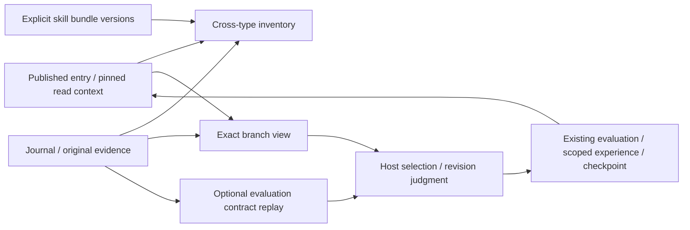

# Optional inventory, branch context and evaluation

These three readers extend the existing thin harness. They add no database,
mandatory router, fixed Probe phase, resource allocator or automatic activation.
The host can still call component SDKs directly. Normal research results and
negative experiences remain the inputs to later selection.

| Surface | Reused producer and consumer | Added behavior |
| --- | --- | --- |
| `etalon_research_context(view="resources")` | Published evidence scope, original reader, skill snapshot, existing resource descriptors and worksets | Paginated inventory across skill, method, workflow, claim, evidence, experience, verifier and template; unknown applicability stays unknown |
| `etalon_research_context(view="branch", branch_id=...)` | Exact checkpoint branch, graph projection, workset and resource-use verifier | Separate task selection, declared relations, verified use associations, experience categories and later decisions |
| `etalon_method_evaluate(...)` | Original result/accounting refs, protocol, initial conditions, MethodEvaluation, method contract and plan | Fixed declarative checks with separate regression, retention, funnel and cost outcomes |

Old context calls and data schemas remain valid. The first two surfaces are views
of an existing MCP tool; the third is one optional read-only tool. Python callers
can use the same underlying modules without MCP. The existing research-index and
skill-improvement guides point to these capabilities; the skill registry gains no
mandatory skill or automatic trigger.

## Identity and bounded coverage

Catalog discovery covers only an explicitly published workspace and explicitly
selected skill bundles. A descriptor is a source declaration, not demonstrated
applicability. A method record can be inventoried while its opaque method content
remains unverified; the row says so. Follow the catalog cursor even after an empty
filtered page. Source errors and missing counterevidence remain coverage gaps.

Branch selection uses exact task and branch identities. Task-wide workset members
are never inferred to have run on every branch. Resource-use associations need
their exact node/use/evaluation/decision refs. Unrecorded historical consumption
stays unknown, including when the associated scientific run succeeded.

Graph traversal, branch delivery and usage discovery have separate bounds and
cursors. A complete source inventory is not complete scientific coverage. The
branch view preserves graph truncation and incomplete counter-context; an omitted
large object returns an exact follow-up reference rather than partial semantics.
New MCP resource/branch pages serialize compactly and check the total text budget.

## Judgment and archival

Evaluation rules select exact JSON fields and use a fixed operation set, with
explicit denominators. Missing values, altered checks and incomparable protocols
cannot yield a pass. Cost success does not erase quality failure. A passed report
means only that the declared rules passed on those observations.

`record_evaluation_artifact` can archive a contract/report as an ordinary Artifact;
reports are recomputed before archival. Its ref can enter the existing
`composition.record_evaluation` and revision/experience interfaces. The host
decides adoption scope. Retrospective rule replay does not prove independent
benefit or chronological freezing. Hook delivery still conveys sourced data and
does not adopt a resource or trigger another evaluation.

For SND1, solver-cost equivalence and fixed-core pose choice are different
decisions. For PoseBusters, fewer CNN calls can coexist with fewer valid top-1
poses. Their evaluation rules and method parameters must not be exchanged merely
because both tasks process molecules. Partial reuse or a compatible template can
be recorded using the existing adaptation review and task workset.

Detailed contracts: [resource inventory](RESOURCE_CATALOG.md),
[branch context](BRANCH_RESOURCE_VIEW.md),
[evaluation rules](EVALUATION_CONTRACT.md).
