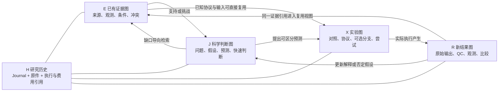

# ETALON 四图研究记忆与方法改进设计

日期：2026-10-21。状态：设计稿，尚未实现。面向总控、ETALON 组件和后续研究 chat。

本方案将研究组织为四张相互连接的关系图：已有证据 E、科学判断 J、实验 X、新结果 R。四图共享可追溯的研究历史 H；宿主根据当前问题选择要读取、补充或执行的分支。memory 保存能影响后续判断的事实、条件、决策和未完成事项，支持新 chat 从当前研究位置继续。RSI 的改进对象限于科学方法 S 和方法使用及分支选择 U。

**本轮不设计资源分配优化，不写实现，不恢复暂停的科学任务。** 已有预算检查、执行预留、收据、费用和恢复机制继续使用。GPU 配额、跨资源池调度、自动并发伸缩、lab 资源分配不进入本方案。R4b 状态仍以 [科学状态边界](SCOPE.md) 的暂停声明为准。

## 1 已确定的设计边界

| 决定 | 具体含义 |
| --- | --- |
| 四图是同一研究历史的关系视图 | 不建立四套数据库；跨图引用同一证据身份，不复制成四份独立证据 |
| 每层工作量可为零 | 已有证据足够时只读引用；已有判断仍有效时直接选择实验；只需更正解释时不启动实验 |
| 分叉可以选择、合并、跳过和停止 | 不要求所有候选路径都运行，也不要求每轮遍历四层 |
| memory 不是聊天记录全集 | 保留结论、简洁理由、可复算推导、原件和状态；不把逐句对话或瞬时思考当作研究事实 |
| 技能和图记录保持可选 | 已知 SDK、原件和方法仍可直接使用；完整图、技能注册或 RSI 评价不成为普通调用的前置门槛 |
| 落档、打分、优化分开 | 事实及时保存；有可观测结果再打分；满足触发条件才提出改进 |
| 方法和选择分开改进 | S 改进某一步怎么做，U 改进接下来做什么、读什么、跳过什么；G 是产生改进的已绑定方法，本轮不再增加 G 自我优化循环 |
| 历史保持不可变 | 更正用新版本和 supersedes；方法回滚只改变后续选择，不抹掉结果、失败、费用和旧配置 |

## 2 四张图怎样连接

概念上的研究链路是：已有证据 → 科学判断 → 有区分力的实验 → 新结果 → 可复用证据。实际关系允许回到任何相关节点，或从已有节点直接开始。网络可有反馈；每条具体记录的版本来源必须可追溯。

图中箭头表示关系，不表示必须执行的流水线。一次读取和一次新测量必须能区分；同一实验被多篇论文、多个摘要或多个 graph 引用，不增加独立样本数。

| 图 | 节点内容 | 主要关系 | 对下一步的用途 |
| --- | --- | --- | --- |
| E 证据图 | 来源、原始实验、分子或研究对象、测量、查询范围、已知协议 | 来源于、同一实验、支持、反对、条件适用、重复报告 | 判断还缺什么，避免重复搜索，定位反证和原件 |
| J 判断图 | 研究问题、竞争解释、假设条件、局部理论、快速计算、区分性预测 | 依赖、支持、矛盾、适用于、替代旧判断 | 明确哪种结果能够改变当前判断 |
| X 实验图 | 候选计划、比较组、协议版本、实际尝试、恢复或重分析 | 检验某预测、前置依赖、共享输入、分支、合并、重复或干预 | 选择最能区分解释的可行下一步 |
| R 结果图 | 原始输出、完整性检查、QC、观测、失败、未知、比较、golden 成员 | 由尝试产生、通过或未通过 QC、支持或否定预测、纳入某版本数据集 | 形成新证据，更新判断和方法评价 |

**R 与 E 的区别是使用视角。** R 描述本次结果如何产生、能否使用；E 描述这些结果如何成为后续问题的证据。同一个 Observation 或 Artifact 可以同时出现在两图中。进入 E 不等于通过所有科学有效性检查；未经确认的结果仍携带其状态，只能支持相应范围的判断。

图节点优先引用现有 Record/EvidenceRef。问题、候选分支和稳定的实验计划可以用项目范围的逻辑 ID 标识，其每次变更对应新的内容版本；逻辑 ID 不能替代版本引用。新增关系表达为 `from_ref / relation / to_ref / conditions / basis_refs`，保存在普通 Artifact 中，图本身由这些记录投影得到。结构相似、同一分子、同一实验和相同字节是不同关系，不自动合并。

本方案借鉴前面讨论的 NS 案例中“多路线探索、共享有用结果、调整研究方向”的组织思路。四图、memory 契约和 RSI 触发机制是 ETALON 的设计选择，不据此推断该案例内部的调度算法。

## 3 怎样选择一层或一个分支

宿主首先读取与当前问题有关的记录，再形成一个小范围的 frontier：当前尚值得考虑的分支集合。它是可重建的工作视图，不是全局任务调度器。没有 frontier 文件时，宿主仍可直接研究。

每个分支记录：问题、竞争解释、可区分预测、所需输入、已有结果、适用条件、当前状态和重新考虑条件。选择动作包括 `read / search / quick_check / experiment / reuse / fork / merge / defer / stop`。一次选择可以只读取已有结果，不产生科学执行。

| 判断 | 采用的动作 | memory 要保留什么 |
| --- | --- | --- |
| 证据已覆盖当前问题且条件匹配 | reuse，搜索层不新增任务 | 使用的 EvidenceRefs、覆盖范围和匹配条件 |
| 检索过但来源或范围不完整 | 只补充缺口 | 既有查询范围、未覆盖来源、增量查询理由 |
| 多条分支共享同一个关键前提 | 先验证共同前提 | 共同依赖、受影响分支；避免重复验证 |
| 某实验在竞争解释下给出相同预测 | defer 或 stop | 无区分力的依据、适用条件和重新考虑条件 |
| 分支被反证排除 | stop | 具体反证、排除范围；不外推到所有条件 |
| 价值暂时无法判断 | 标记不确定，选择是否做快速判断 | 未知项；不能写成已证明无产出 |
| 输入尚缺或任务仍在运行 | defer 或读取原 handle | 等待项、既有 request/action/job 身份 |
| 新证据使原排除条件失效 | 新建 reconsider 决策 | 原停止记录、新证据和新的候选版本 |

分支状态采用 `open / active / waiting / resolved / stopped`；reuse、skip、merge 是决策动作，不另造观测状态。停止不删除节点；重开形成新状态记录，旧决定仍可解释当时的选择。

**不把“执行得多”作为好选择。** 复用有效证据、结束无价值分支、保留合理的不确定性，都可能是正确结果。一个分支被跳过时，其实际科学结果仍是未知，不能补一个低分或负样本。

## 4 memory 保存什么

memory 分为不可变历史、可重建索引和当前工作视图三部分。权威历史使用现有 ResearchJournal/CampaignStore、原始 Artifact 和执行收据；索引、四图和新 chat 摘要只提供导航。CampaignStore 的费用与 Runtime 的执行状态仍各司其职，不新建 memory 费用账本。

| 内容 | 最小记录 | 不应混淆的事项 |
| --- | --- | --- |
| 搜索与证据选择 | 查询、来源、时间或快照、对象及条件、覆盖/错误/截断、选取和排除的引用与理由 | 空结果不代表不存在；摘要不代替原始数据 |
| claim 与科学判断 | question、statement、epistemic_status、subjects、conditions、limitations、support_refs、counter_refs、method_refs、supersedes | claim 校验只证明结构合法；理论推导、数值现象、工程结果和 lab 结论分别说明范围 |
| 实验计划 | 要区分的解释、预期读出、对照、阈值、协议/输入版本、停止条件 | 计划不伪装成已运行 Experiment 或 Observation |
| 实际实验 | 现有 Experiment、Observation、原始输出与 action 引用 | 恢复、重分析、独立重复和条件干预分别标识 |
| 分支决定 | 当时可见证据、候选集合、被选和未选项、简洁理由、重新考虑条件 | 不把后来获知的信息写成当时已知 |
| 方法变化 | MethodVersion、MethodUse、MethodEvaluation、method revision | 可用、读过、实际采用、得到收益是不同事实 |
| golden 与评价 | 成员版本、标签与来源、端点/条件、QC、划分、暴露历史、分母和缺失项 | 已见回归集不等于未见科学验证 |
| 接续信息 | 当前问题、有效前沿、关键支持与反证、待完成 handle、版本、状态入口、水位 | 摘要不能授予授权或恢复暂停任务 |

不默认保存完整聊天、重复复制的论文、无法核验的“记得”、未测得的成功率或用零填充的未知费用。需要保存的是简洁判断依据、可复算的推导/计算及其产物，而不是宿主内部逐步思考。

### 拟新增的内容契约

以下名称均为设计中的 Artifact 内容 schema，不是当前已经支持的 Python 类型或 SDK API。首版复用 Artifact 容器，不增加第二套 Journal。普通调用无需逐项填齐这些对象；只有声明相应接续、复用或 RSI 评价时才要求所依赖字段完整。

| 拟新增契约 | 字段组与用途 |
| --- | --- |
| `etalon-research-step/1` | project_id、question_id、branch_id、operation、input_refs、output_refs、source_watermarks、method_use_ref、decision、reason、accounting_refs、open_questions、supersedes；记录一个有意义的研究状态变化 |
| `etalon-evidence-search/1` | query、source_scope、entity/condition_scope、searched_at、source_snapshot_or_watermark、coverage、truncation、errors、selected_refs、excluded_refs_with_reason、refresh_condition；支持判断是否需要重搜 |
| `etalon-research-branch/1` | branch_id、parent_branch_refs、question_refs、hypothesis_refs、prediction、plan_ref、input_requirements、state、decision_context、reconsider_when、supersedes；decision_context 包含候选集合、选中项、未选原因和可见证据 |
| `etalon-experiment-plan/1` | hypothesis/prediction_refs、controls、endpoint/units、protocol/input_refs、decision_rule、stop_rule、planned_comparisons；支持一般实验意图，不扩大现有 Experiment.kind 的含义 |
| `etalon-research-relations/1` | 有类型的关系列表、每条关系的条件与依据、来源水位、投影版本；不靠文本相似度生成“已确认支持”关系 |
| `etalon-research-handoff/1` | question/scope、status_refs、workspace_ref、frontier_refs、key_support/counter_refs、pending_handles、method/protocol/model_pins、default_selection_ref、watermarks、owner、supersedes |
| `etalon-golden-manifest/1` | dataset_version、purpose、members、selection_rule、identity/endpoint_scope、QC_rule、labels_and_refs、group_split、exposure_records、supersedes |
| `etalon-research-assessment/1` | subject_refs、protocol_ref、cohort/member_refs、metrics 各自的 numerator/denominator/unknown/exclusions、evidence_refs、accounting_refs、scope、comparison_status；同时承载漏斗与分支诊断指标 |
| `etalon-method-choice/1` | scope、previous_choice_ref、selected_version_refs、evidence_refs、reason、effective_from、rollback_target、supersedes；描述后续默认选择，不修改运行中任务 |

不同项目可以只采用需要的内容契约。重复字段优先用引用，不在 step 中复制整份实验或分支状态。时间只是元信息；是否为同一次尝试由 task/request/action/attempt 身份和内容共同判断，独立重复不能因相同结果字节被去掉。

引用规则也分两层：跨来源引用使用带 source_id、record_id、record_digest 的 EvidenceRef；现有 Journal 类型要求本库字符串 ID 的字段继续使用其原格式。接入跨库原件时需要显式本地来源封装或解析适配，不能直接把 EvidenceRef 塞进现有字符串字段。

## 5 什么时候落档和怎样更新

| 时机 | 写入动作 | 一致性要求 |
| --- | --- | --- |
| 查询完成或中止 | 保存有后续复用价值的查询覆盖、缺口和选择结果 | 失败、权限不足、截断与真正空结果分开 |
| 形成影响下一步的判断 | 保存 claim、依据和相关 step | 反证与条件一起记录；纯文字润色不必制造新研究步骤 |
| 选择、停止或合并分支 | 保存当时决策与分支版本 | 后来重评追加新记录，保留旧可见信息边界 |
| 发起真实尝试 | 先持久化输入/协议/请求身份，沿用现有提交与预留路径 | Experiment 的 action_ids 只能引用已存在的 action；计划留在 plan Artifact |
| 收到输出、失败或中断信息 | 先保留原始输出与收据，再 QC、观测和比较 | 无效数值不能进入训练标签；原始失败不能丢失 |
| 形成阶段结论或交接 | 更新四图投影、当前前沿和接续快照 | 快照带来源水位；同一时刻无法一致读取时明确不完整 |
| 发现错误或新反证 | 追加更正 claim/记录，产生 supersedes 和依赖复查项 | 不覆盖旧原件；撤回的证据仍可追溯，但不继续作为当前有效依据 |
| 方法试用、评价、采用或回退 | 保存版本、实际使用、评价及 choice | 候选、试用和默认采用分开；记录失败和 no-change |

文件和数据库是两次提交：先完整写入内容寻址文件并核验，再 `journal.record(Artifact)`。Journal 失败时保留可核验的孤立文件供重试；只有文件而没有研究记录，不能声称已经完成落档。复用现有 method_revision 写入方式，新增通用 helper 时保持同样边界。其幂等性不应被描述为跨文件系统与数据库的原子事务。

原始事实可以即时提交；step 汇总、关系投影和接续快照可以在一小批操作结束后生成。索引失败不回滚科学事实，也不自动重跑实验。重试事件处理采用稳定 request ID；重复事件不能重复产生科学执行或累计同一费用。

更正采用追加式语义：新记录声明替代哪一条、在哪些条件下替代、为什么。多个来源的矛盾结论可以并存，不按“最后写入”判定科学真伪。四图读取侧标记受影响后代需要复查；不因为上游改了一个字段就自动重算所有昂贵实验。

## 6 怎样检索和避免重复搜索

推荐读取顺序是：**已知引用 → 小范围结构化检索 → 支持与反证关系 → 必要原件 → 仅为缺口做外部搜索。** 每一步都可直接结束；不强制先跑搜索再读已知文件。

1. 根据项目入口确定当前问题、状态和允许读取的 evidence workspace。已知 EvidenceRef 时直接 read。
2. 按 task/entity/method/role 等现有过滤条件限定问题，再用关键词检索。首版优先身份匹配和明确条件，避免只按词相似就复用不相容端点。
3. 对候选结果读取 conditions、limitations、support/counter、版本来源及可用性；沿直接关系扩展必要邻居。跨多跳检索必须有跳数、记录数和输出大小上限，并报告截断。
4. 对决定性证据核验原件哈希、端点、协议及身份。来源相同的重复报告归组，但保留各自引用。
5. 根据查询记录判断已覆盖范围。只针对缺失来源、新时间段、不同条件或过期依据发起新搜索。
6. 返回“已找到什么、未覆盖什么、哪些仍冲突、下一步缺哪条证据”，而不是只返回一段无法追溯的总结。

重复搜索判断使用查询意图、实体/条件、来源范围及来源快照。文献库更新、问题条件变化、旧检索截断、来源恢复可用，都可以触发刷新。一次“未找到”只在其范围和时间内有效；首版不设所有任务共用的固定失效天数。

**当前可直接复用：** `query_evidence` 支持有界文本与结构化过滤，`read_evidence` 支持 record/summary/lineage/artifact；游标随查询、workspace 或来源水位改变而失效；location_map 支持在哈希校验下迁移原件。

**当前限制：** query 是大小写折叠后的子串匹配，并非语义搜索；结果按来源及记录 ID 排序，不代表相关性排名。实现先 `_collect` 再过滤 source_ids，因此少量命中并不保证只读取少量来源。lineage 是直接发布关系，不是递归图查询。内容投影仅支持 claim 和 method_revision；新增 JSON 即便作为 Artifact 入库，也不会自动变成可搜索内容。

因此新增工作包括：显式 schema 校验及投影、带类型的关系遍历、反向依赖索引、覆盖可见的查询记录和小范围发布。索引是可重建缓存，按来源身份、水位和投影版本失效；底层记录才是依据。全文或向量索引留作经实际检索失败证明有必要后的扩展，本轮不把向量数据库设为前置条件。

封存证据通过实际发布范围和访问隔离保护。`role`、过滤器和摘要里的“勿读”不能代替隔离；索引、派生摘要与接续文件也不能泄露封存标签。现有 publish_journals 示例会备份指定库，不能直接当作逐记录脱敏发布器。

## 7 新 chat 怎么接着研究

保留现有四行项目入口思路：项目与问题、权威状态入口、已发布 evidence workspace、允许自由选择方法。新增一个可选 handoff 引用；入口本身保持短，不注入整个图或聊天历史。

handoff 保存“从哪里继续找”的信息：当前问题及范围、前沿分支、关键支持/反证、尚未解决的问题、待完成 request/action/job/plan handle、已绑定的方法/协议/模型版本、来源水位、当前写入负责人。它不复制全部原件，也不覆盖权威暂停或权限状态。

新 chat 的接续流程：

1. 读取当前状态，确认暂停、授权范围和写入归属；R4b 的暂停优先于旧 handoff 中的待办。
2. 解析 workspace 和 handoff，比较来源身份、水位与当前版本；过期快照只当导航，读取变化后重新形成当前视图。
3. 优先读取未终结 handle 的状态和既有收据。响应未知时保持 pending，不因新 chat 没见过提交过程就再发一次。
4. 读取当前分支所需的少量关键证据和反证，核验条件；不要求先遍历全部历史。
5. 决定 reuse、补检索、快速判断、实验、换分支或停止。可继续原分支，也可说明理由后修改方向。
6. 有新事实或决定才追加记录，阶段结束形成新的 handoff。纯读取不强制产生新的研究版本。

跨 chat 的可写接续先沿用当前单写负责人约定。涉及实际执行时仍使用持久 request ID 和现有幂等路径。若以后允许多个 chat 同时更新同一前沿，需要新增带预期水位的条件更新或冲突检测；现有项目入口文档不提供这项并发协调保证，本轮不扩展为资源调度服务。

## 8 实验漏斗与 golden 怎样进入 memory

X 图内的漏斗是可分叉、可合并的实验集合。每一关说明它检验的预测、适用人群、读出、阈值、误差和下一步条件。便宜检查、快速计算、高可信计算和 lab 可组成局部链路；已有合格结果可以复用，某一关不适用时可走有科学依据的替代路径。跳过计算层不能跳过必要的输入身份或科学准入检查。

“回归率”拆成以下指标，不合成一个百分数：

| 指标 | 分子与分母 | 必须一起报告 |
| --- | --- | --- |
| golden 回归通过率 | 符合预定期望的有效检查 / 有效完成的检查 | 完成覆盖率、未运行/失败/未知；正例、反例、错误处理和边界检查分组 |
| 已知阳性保留率 | 被保留的已知阳性 / 实际进入该关的全部已知阳性 | 未判定数量及上下界；不能把丢失结果从分母静默删除 |
| 候选通过率 | 通过本关的候选 / 进入本关的候选 | 按唯一身份统计，失败/待定单列，声明阈值和人群 |
| lab 确认率 | 达到预定实验标准的候选 / 获得有效可比实验读出的候选 | 有效读出覆盖率＝有效读出数 / 计划测试数 |
| 端到端命中率 | 已确认候选 / 原始冻结候选集合 | 尚未实验部分为未知；当前确认比例可作为下界，不能替代全体真实活性率 |

每项保存成员引用、分子、分母、排除理由、缺失与协议版本；分母为零时结果为 null。路径交叉或人群变化时不能直接相乘各关通过率。只验证幸存者无法估计被剔除分支的漏失；若研究目标需要估计该项，评价计划应预先保留阳性对照或有授权的拒绝样本抽查。

golden 是版本化、可解释的参考数据集，而不只是“成功结果合集”。可包含阳性、阴性、边界、不适用与已知错误案例。失败记录可测试错误处理，但不转化为虚构亲和力标签。计算协议回归集与 lab 结论集分开用途，Kd/Ki/IC50 等端点保留各自定义和条件。

候选结果进入 golden 前绑定原件、身份、测量条件、QC、标签依据、选择规则和使用角色。数据更正形成新 manifest 并指向旧版本。开发数据、已知回归集、未见验证任务的暴露历史分别记录；独立评价用过的结果以后可作为已见反馈，但不能换一个名字再次称未见验证。

“合成”沿用两种含义：证据合成在 J 图产生带 support/counter 的 claim；化学合成或采购路线属于 X 图候选计划，其实物批次、QC 和实验读出进入 R 图。现有 assay 导入和供应来源查询不等于完整实时 lab 链路；后者未来需增加样品/批次、协议、交付和原始读出接口。本轮只规定其证据接入边界。

## 9 方法和分支选择的 RSI 怎么触发

RSI 拆成四个不同时间尺度：**事实落档 → 有依据的评价 → 有界改进试用 → 后续采用或回退。** 每步可以积累 memory，但普通读取、一个新记录或一次低分不自动导致方法自我重写。

### 方法 S 和选择 U 的归因

| 对象 | 改什么 | 评价时固定什么 | 典型证据 |
| --- | --- | --- | --- |
| S 科学方法 | 检索、证据区分、计算、实验设计、QC 或合成方法内部的做法 | 尽量固定任务、信息起点、分支和读出协议 | 正确性、有效覆盖、区分力、误差、阳性保留、失败率及实际费用 |
| U 方法使用和分支选择 | 选哪条分支、复用还是补搜、何时快速判断、何时停止，以及方法组合 | 尽量固定可用方法版本、任务、可见信息和授权上限 | 决策是否解决问题、遗漏有价值分支、重复工作、合理停止、最终科学结果及费用 |

S 和 U 同时改变时，先做分开对照；条件允许再做旧 S/新 S × 旧 U/新 U 的交叉比较。现有 Contrast 只适合满足其约束的 2×2 观测，不强行承载任意多分支比较。旧 research 模块中的数值策略 φ 保留原含义，不把所有 U 都改名为 φ。

对未执行分支的收益保持未知。回放已记录的选择可以检查一致性，不能证明未执行分支会失败，也不能证明新 U 已经取得真实在线收益。U 的评价需要在固定信息边界下比较决策；要声明收益，还需要有真实结果或有效的独立评价协议支撑。记录当时候选集合与可见证据，是避免事后归因的关键。

### 触发条件与停止规则

| 事件 | 即时处理 | 何时进入改进 |
| --- | --- | --- |
| 普通搜索、读取、分支跳过 | 需要时记录，不自动改进 | 没有具体问题证据时不进入 |
| 明确的身份/单位/引用错误或可信反例 | 保存错误和影响范围，撤出受影响的默认选择或暂停该局部使用 | 单个已核验严重问题即可提出有界修复候选；不先要求凑够样本 |
| 多个独立任务重复出现同类失败 | 按独立任务组聚合，避免把重复尝试计多次 | 达到项目预先声明的数量和影响阈值后进入；阈值未定义时交由宿主明确判断 |
| 新证据改变方法适用性 | 更新 claim、复查依赖分支 | 若暴露可修正的具体机制或适用范围，再提出候选 |
| 阶段完成或用户主动要求 | 汇总 S/U 评价、成本和未解决项 | 有明确改进目标时做一次有界尝试，也允许 no-change |
| 新方法版本生成或写入一条方法记录 | 保存来源和版本 | 生成事件本身不触发下一轮生成，防止递归优化循环 |

首版建议由宿主在自然研究边界显式调用一次评价/改进；可选事件 hook 只处理明确列出的事件和内容 schema。复用 `consume_events` 的单页、log-bound cursor 和稳定 request ID。新增 handler 负责按“问题、目标版本、触发证据集合”去重，合并重复信号，并在同一改进尝试未结束时抑制重复触发。

具体数字阈值、最小有效改进、容许退化、评价窗口和改进尝试上限写入项目的评价协议，在比较前冻结。当前证据不足以为所有科学问题指定同一阈值。达到上限、无法得到区分性证据或预期修复没有奏效时，保存 no-change/失败及成本，回到研究问题；不为完成“RSI 一轮”继续生成。

### 一次有界改进的完整路径

1. 用 problem_refs 指向具体缺陷，确定改 S 还是 U，说明适用范围和机制假设。
2. 固定基线版本、任务与信息起点、比较协议和评价角色；G 只作为本次候选产生者绑定版本和实际使用。
3. 产生零个或有限个候选。零个候选是合法 no-change；保存生成、筛选与失败成本。
4. 在已有授权范围内做诊断或局部试用。可以先使用候选解决当前问题，但不能因此声称已验证普遍收益。
5. 要改变共享默认方法或宣称可迁移收益时，使用与结论匹配的回归和独立比较；保留便宜基线、没有改变的结果和不适用范围。
6. 将实际比较写入 MethodEvaluation；新选择写入 choice Artifact。后续任务绑定确切版本，不热替换正在运行任务。
7. 新证据表明退化时，追加回退选择和理由，恢复已知可用的旧版本；保留失败候选及全部历史。

评价使用指标向量，不默认用 LLM 自评压成统一总分。若任务确需费用加权效用，其权重和科学损失定义必须事先写入协议。费用用于核算和比较，在本方案中不驱动 GPU 数量、并发配额或资源池分配。

## 10 与现有代码的对应关系

以下“直接复用”指当前本地工作树存在相应实现，不表示新增设计已经运行或已经取得科学收益。设计核对源于 `5927aceb346475a6f97550f561e7eb3b291611da` 及当时未提交的工作树修改；现有实现已另行冻结为本分支的源码快照；[SOURCE_MANIFEST.json](SOURCE_MANIFEST.json) 记录所引源码字节身份，不能只用 HEAD 指代它们。

| 能力 | 结论 | 当前入口与需要补的部分 |
| --- | --- | --- |
| 不可变历史与同库研究记录 | 直接复用 | [ResearchJournal.record](../../../src/etalon/research/journal.py#L76)；复用 CampaignStore，不另建成本账本 |
| Artifact 原件与身份验证 | 直接复用 | [Artifact](../../../src/etalon/research/schema.py#L26)、[artifact_path](../../../src/etalon/research/journal.py#L46)；source_kind、role、hash、bytes 继续真实填写 |
| claim 结构与更正引用 | 直接复用结构，扩展公共写入辅助 | [validate_claim](../../../src/etalon/research/evidence_refs.py#L237) 已支持；[record_claim](../../../examples/evidence_reuse.py#L19) 当前是示例 helper，claim 作为 Artifact 保存，不是 Journal 原生 Record 类型 |
| EvidenceRef、迁移与发布范围 | 直接复用基础，新增更细发布工具 | [evidence_refs.py](../../../src/etalon/research/evidence_refs.py#L71)；跨库解析和封存隔离必须保留，不能直接暴露整库 |
| 有界检索与直接关系读取 | 直接复用基础，扩展内容及关系读取 | [query_evidence](../../../src/etalon/research/evidence.py#L324)、[read_evidence](../../../src/etalon/research/evidence.py#L384)；新增 schema 投影、查询覆盖、类型关系和可重建索引 |
| 实验与观测 | 在既有语义内复用 | [Experiment](../../../src/etalon/research/schema.py#L84)、[Observation](../../../src/etalon/research/schema.py#L114)；一般实验计划另用 plan Artifact，不伪造 action 或 kind |
| 对照与配置修订 | 有条件复用 | [Contrast](../../../src/etalon/research/schema.py#L135)、[Revision](../../../src/etalon/research/schema.py#L153)；2×2 及具体配置修订约束保留，通用图比较不硬塞入其中 |
| 单次行动、预留、收据、恢复 | 直接复用 | [runtime/api.py](../../../src/etalon/runtime/api.py#L115)、[ActiveCampaign.evaluate](../../../src/etalon/active/runner.py#L226)；不另设执行器或调度层 |
| 方法内容、使用与评价 | 复用记录；独立评价适配需扩展 | [MethodVersion/Use/Evaluation](../../../src/etalon/research/schema.py#L196)；当前 use 只接受 host_reported；通用 S/U 评价仍受既有冻结策略验证收据路径限制 |
| 方法改进来源与 no-change | 直接复用 | [method_revision.py](../../../src/etalon/research/method_revision.py#L31) 支持 S/U/G、问题证据、候选、试用和成本；G 自优化不进入本轮 |
| 事件读取与稳定触发 ID | 直接复用消费基础，新增触发规则 | [consume_events](../../../src/etalon/host.py#L224)；当前不是自动改进调度器，handler 去重和有界改进状态需要新增 |
| 新 chat 短入口 | 直接复用指引，新增接续产物 | [project-entry.md](../../../src/etalon/host-guides/project-entry.md#L1)；handoff、前沿重建和过期检测需新增 |
| 四图与分支决策 | 新增 | 类型关系投影、branch/step/plan 内容契约、重新考虑条件；宿主继续决定下一步 |
| golden 与统一漏斗评价 | 新增组合契约 | 复用现有观测、校准、TaskSplit 和数据身份；增加 manifest、暴露记录及明确分母的 assessment |
| 方法默认采用与回退 | 新增选择记录和应用约定 | 现有记录不会自动晋升方法；choice 只影响后续任务的版本绑定 |
| 实验数据入口 | 复用历史导入；实时 lab 另有缺口 | [import_assays](../../../src/etalon/data/ingress.py#L37) 不代表实时 lab 执行；未来按样品批次和协议接入，不在本轮实现 |

两个实现边界需要保留：第一，Journal 独立 MethodEvaluation 目前要求已有 `validation-` 收据、冻结 policy/split 和时间顺序，不能把任意实验结果列表直接标为独立 S/U 验证。后续应增加明确适配或另立一般评价契约，同时保留原路径的强校验。第二，现有 evidence 内容投影有 schema 白名单和大小/数量上限；新增内容契约必须同时考虑验证、投影、关系识别、发布隔离及错误回读，不能只加写入端。

## 11 后续实现切片和验收条件

本节定义以后如何实施和验证，不代表本轮启动。各切片保持旧 SDK、旧记录和可选 host 行为兼容。

| 切片 | 交付边界 | 最小有区分力验收 |
| --- | --- | --- |
| A memory 与四图 | 内容 schema、不可变 Artifact helper、投影与关系读取 | 一个已有证据进入多图仍只有同一证据身份；更正后保留旧版本并找到受影响分支；不安装索引也能读取原件 |
| B 分支与新 chat | branch/step、前沿视图、handoff 与过期检查 | 新 chat 只读必要证据接续；已有搜索可跳过；pending 不重复提交；暂停仍有效；没有 handoff 也可直接用 SDK |
| C 漏斗与 golden | member manifest、暴露历史、明确分母的 assessment | 正负/失败/缺失分开；交叉路径不重复计人；旧测试反馈不能伪装成新未见评价 |
| D S/U 改进闭环 | 问题触发、有限候选、比较适配、choice 与回退 | 严重反例可触发一次修复；重复事件不重复试用；方法记录不递归触发；no-change 和失败费用保留；只改变 S 与只改变 U 可区分 |

贯通验证需要同时检查生产与消费：记录写入者输出合法 schema；检索和 graph 消费者能解析或明确返回 unsupported；新 chat 能定位同一原件；方法评价引用实际结果和费用；选择记录能约束后续绑定。旧消费者遇到新 Artifact 可以保留和直接读取原件，但不应宣称已经理解新的内容语义。

效果评价至少比较“直接已知文件/SDK”“现有 query/read”“新增 memory 辅助”在固定信息条件下的表现，观察关键证据与反证找回、错误引用、重复工作、接续完整性和实际开销。结果不预设新增 memory 更好；只有合适范围的实际证据才支持扩大默认使用。

## 12 一条研究线怎样走完和接续

以下是流程示例，不是实际实验结果。假设当前问题是“候选的表观改善来自目标结合，还是 assay 干扰”，已有一批来源核验过的文献和历史观测。

| 当前动作 | 四图与 memory 的变化 | 是否触发 RSI |
| --- | --- | --- |
| 读取已有证据及检索覆盖 | E 引用现有原件；条件匹配，记录 reuse 决策，外部搜索层零新增任务 | 不触发；重复读取次数不算新证据数量 |
| 比较两个解释的预测 | J 保存两个假设、已知限制及可区分读出；快速计算作为可复算产物引用 | 可记录判断质量，尚无结果时不填写“预测正确率” |
| 排除无法区分解释的一条昂贵计算分支 | X 分支写入 stop，依据是两解释对此读出的相同预测；记录重新考虑条件 | U 留下选择证据；未执行分支收益仍未知 |
| 选择有区分力的对照与必要实验 | X 保存计划、输入及协议版本，通过已有执行路径取得真实尝试身份 | 方法试用不自动等于改进；资源配置保持给定 |
| chat 在结果返回前结束 | handoff 保存问题、两假设、停止理由、原 handle 和水位 | 不产生新科学尝试 |
| 新 chat 接续并读取返回结果 | 先查状态与原 handle；R 保存原件、QC 和观测；若失败只保存失败，不造科学读数 | 明确方法错误可触发 S 诊断；一般失败先分类 |
| 有效结果改变判断 | J 新 claim 引用支持和反证，明确限定；R 的相同 EvidenceRef 进入 E；合格成员进入适当用途的 golden 新版本 | 更新相应分母和覆盖；新证据若暴露可修正问题，产生一次改进请求 |
| 后续独立任务重复暴露同类漏判 | 聚合 U 的历史决策，核对当时可见信息，提出新的选择方法并比较 | 满足预定触发条件后进行有界 U 改进；收益不成立则 no-change 或回退 |

此例中搜索层可以不执行，某条实验分支可以永不执行，新 chat 可以从等待结果处接续。研究仍然具有完整证据链；完整来自身份与关系的连续，而不是四层每次都跑一遍。

## 13 尚需在具体研究任务中确定的参数

架构不再等待这些参数才能讨论，但真正试用前需要在对应任务协议中确定：什么结果足以区分竞争解释、golden 的成员与分组、S/U 的评价指标和最小改进、重复问题触发阈值、检索覆盖与刷新条件，以及默认采用的作用域。宿主可在既有授权内作出这些研究决定，不增加一套普遍审批流程。

资源配置在本方案中只作为已给定的运行条件与费用事实保留；资源分配优化继续延期。当前交付到此为设计文档，不包含源码改动、部署、科学执行或新的实验结果。
